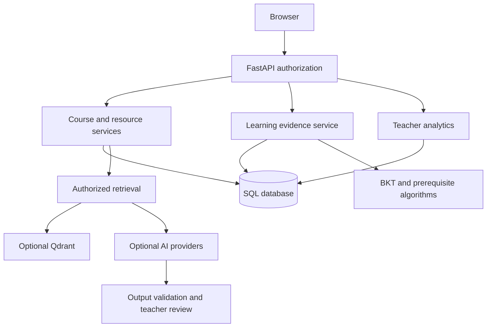

# Architecture and trust boundaries

The browser is never the authority for identity, correct answers, course access or official grades. Database scope is established before retrieval and analytics. Student uploads have an owner ID; course material has no private owner. Every teacher query checks course ownership or an active co-teacher assignment. Admin does not automatically receive a teacher's student endpoint permissions.

The initial schema deliberately uses fewer entities than the full brief: user profile JSON instead of role-specific profile tables, a course row carrying its section rather than a separate Section entity, and CLO codes on topics rather than normalized CLO/TopicCLO tables. Version 0.2 adds TeacherAssignment, StudyPlan/StudyTask, Notification, ResourceBlob and VivaSession/VivaTurn entities. These are documented implementation boundaries, not claims of full schema completion.

Session tokens and faculty invites are digest-only in storage. Providers receive authorized excerpts or submitted audio, not browser cookies. No provider output directly grants a role or changes an official grade. Generated curriculum and questions require explicit teacher review. Quiz observation updates are deterministic and transactional.

External AI, vector and mail services are optional for the local demonstration. A provider outage falls back to located text or an actionable typed/manual workflow. Full asynchronous job orchestration and autonomous agent coordination are future work, not hidden behind decorative labels.

## Universal material and formal viva model (0.3)

The new subject-independent path is app/services/materials.py → app/ai/grounded.py → app/api/universal.py and app/api/formal_viva.py. Course.material_only controls strict source use; chunk/topic structure JSON holds book, unit, chapter, section, page, subtopics and quoted concept provenance. Topic prerequisites remain validated graph edges. Question and assignment source IDs link teacher evidence.

VivaExam stores scope/config JSON, VivaQuestion stores approved prompt/expected points/rubric metadata/source snapshots, OralSession stores the student's cursor/turn/deadline, OralResponse stores transcripts and structured evaluation, and OralReview stores teacher marks and finalization evidence. Scope and evaluation are JSON in these records, not separate normalized VivaMaterialScope/VivaEvaluation tables. Frozen schema_v3 and migration 0003_universal_viva add these fields/tables while preserving v1/v2 data.

Draft publication and response/finalization transitions use conditional database updates. Student payloads exclude expected answers and private rubrics; delayed feedback is withheld until completion. Latest response per main question supplies its proposed score, avoiding accumulation across follow-ups. Finalized teacher marks drive official results; explicit auto-finalization is labelled and never updates mastery. The older VivaSession/VivaTurn practice path remains separate for compatibility.
